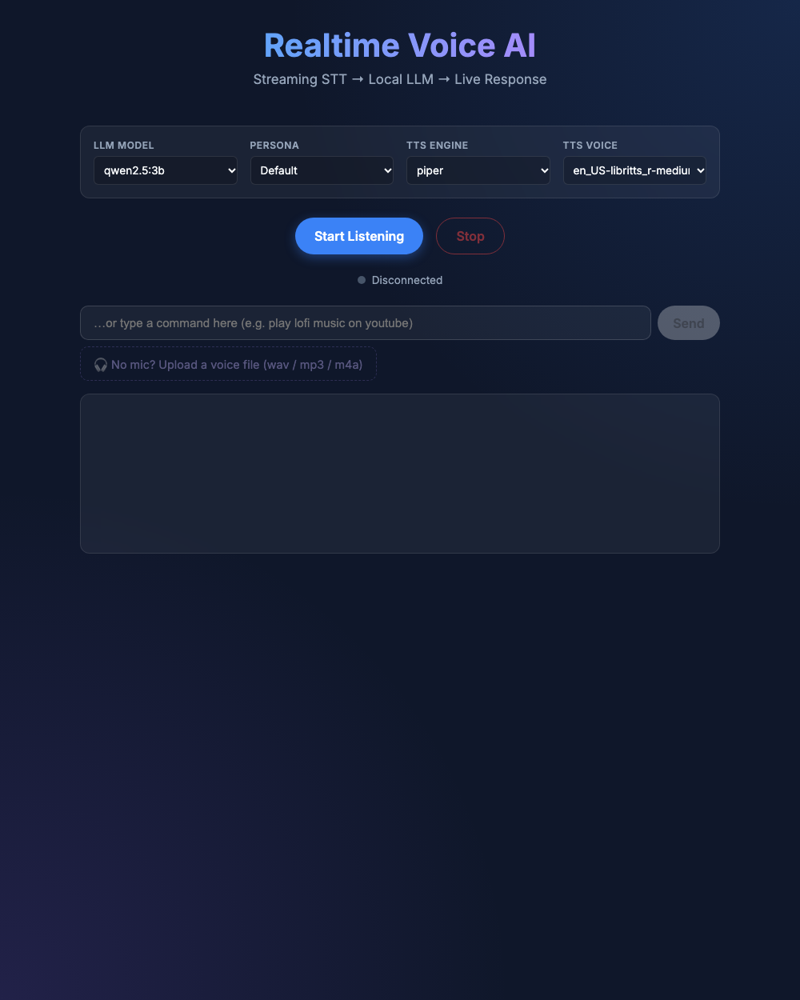
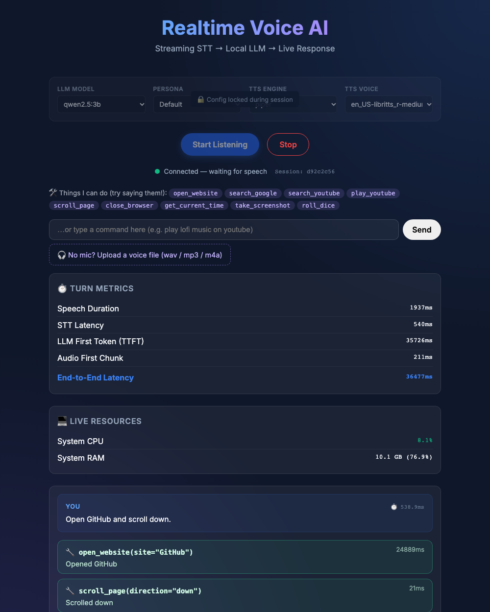
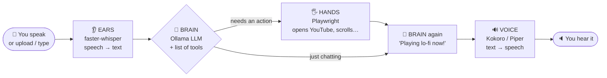
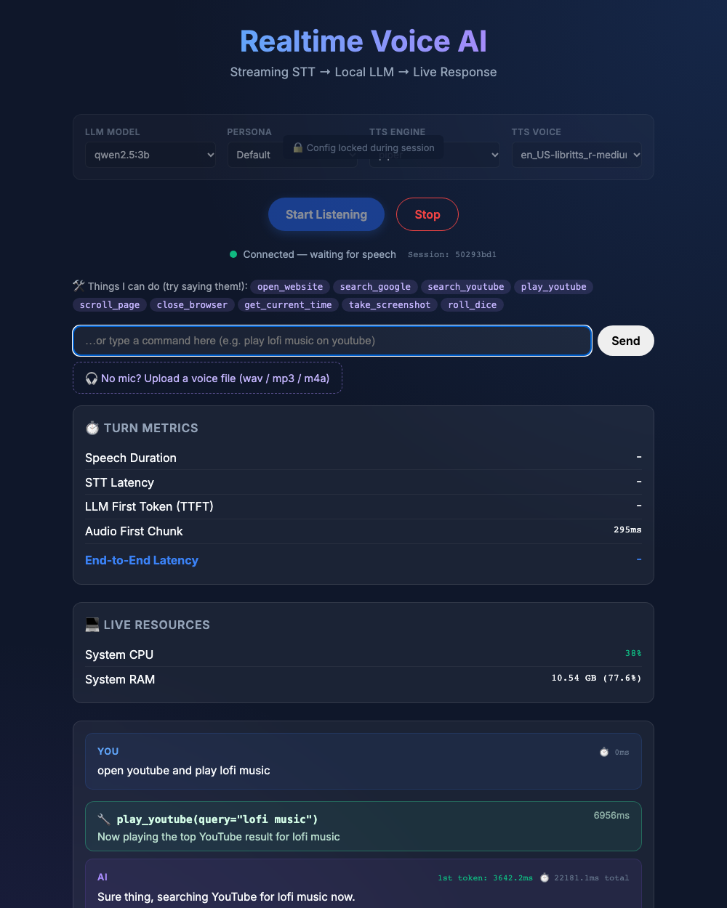
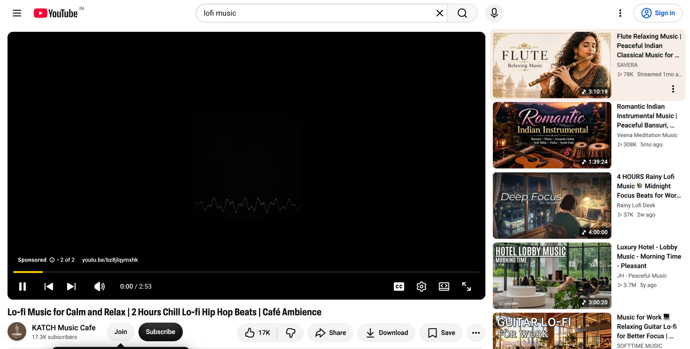

<div align="center">

# 🎙️ Voice Agent That Acts

**Talk to your computer. It talks back — and does things.**

Open YouTube · play a song · search Google · scroll · take a screenshot — all by voice.

**100% local · 100% open source · no API keys · no cloud · no cost**

<br>


<br>


<sub>A real recording of this repo running on a MacBook: the agent hears a command, picks a tool, acts, and answers out loud.<br>Recorded on a heavily loaded laptop, so it looks slower than normal. Typical speeds are in [Performance](#performance).</sub>

<br>

[Quick start](#quick-start) · [Talk to it](#talk-to-it) · [How it works](#how-it-works) · [Add a tool](#add-your-own-tool) · [Configuration](#configuration) · [Troubleshooting](#troubleshooting) · [Contributing](#contributing)

</div>

---

## What is this?

A normal voice assistant is **ears → brain → voice**. This one adds **hands**: the brain can decide to call a tool, and the tool drives a real browser.

- **Fully local and free.** Ollama, faster-whisper, Kokoro/Piper and Playwright. Nothing leaves your machine.
- **One Python function = one new ability.** Decorate it with `@tool` and the agent can use it. No other file to edit.
- **Three ways in.** Microphone, uploaded voice file, or typed text. It always speaks back.
- **Constrained by design.** Only registered tools run: no shell access, unknown tool names are refused, invented arguments are dropped.

---

## Quick start

⏱️ About **15 minutes**, almost all of it downloads. You need a laptop with roughly **8 GB of free RAM**.

### 1. Install the basics *(one time)*

| You need | Why | Notes |
|---|---|---|
| **Git** | get the code | |
| **Python 3.12** | runs the agent | 3.11 also works. **Not 3.13+** |
| **Ollama** | the local AI brain | [ollama.com/download](https://ollama.com/download) |
| **ffmpeg + espeak-ng** | audio helpers | |

<details>
<summary><b>macOS</b></summary>

```bash
brew install git python@3.12 ffmpeg espeak-ng
```
Then install Ollama from [ollama.com/download](https://ollama.com/download).
</details>

<details>
<summary><b>Linux (Ubuntu)</b></summary>

```bash
sudo apt install git python3.12 python3.12-venv ffmpeg espeak-ng
curl -fsSL https://ollama.com/install.sh | sh
```
</details>

<details>
<summary><b>Windows</b></summary>

Use **WSL2** (Ubuntu) and run the Linux commands above inside it, including Ollama.
</details>

> [!TIP]
> Not sure what you already have? Skip ahead. `./setup.sh` checks everything and tells you exactly what's missing.

### 2. Get it running

```bash
git clone https://github.com/coder-irwin/voice-agent-workshop.git
cd voice-agent-workshop

./setup.sh    # one command: Python env, packages, Playwright browser, voice models,
              # and the AI model (~2 GB). Safe to run again.

./run.sh      # start the agent
```

### 3. Talk to it 🎉

Open **http://localhost:8000** in **Chrome**, click **Start Listening**, allow the microphone, and say:

> **"Open YouTube and play lo-fi music."**

> [!IMPORTANT]
> **Use headphones.** Otherwise the agent hears its own voice (and your YouTube video) and interrupts itself.

<div align="center">

</div>

### Things to try saying

| Say… | It does… |
|---|---|
| "Open YouTube and play lo-fi music" | opens YouTube, plays the top result |
| "Search Google for open source voice agents" | runs a Google search |
| "Open GitHub" | opens github.com |
| "Scroll down" | scrolls the page |
| "Take a screenshot" | saves `screenshots/shot_*.png` |
| "What time is it?" | tells you the time |
| "Roll a dice" | a tiny tool students wrote 🎲 |
| "How are you?" | just chats. **No** tool is used |

---

## Talk to it

**A laptop microphone is not required.** All three inputs go through the exact same pipeline, and the agent always **speaks back** through your speakers.

| | Input | How |
|---|---|---|
| 🎤 | **Microphone** | Click *Start Listening* and speak |
| 🎧 | **Voice file** | No mic, or it's blocked? Click **Upload a voice file** and pick any wav / mp3 / m4a, such as a recording from your phone. The session keeps working |
| ⌨️ | **Typing** | Use the text box under the status bar. Perfect for a noisy room |

<div align="center">


<sub>Captured in a browser with <b>no microphone at all</b>: an uploaded mp3 saying "open GitHub and scroll down" → two tool calls → spoken reply.<br>Latency is high here because the laptop was low on memory. See <a href="#performance">Performance</a>.</sub>
</div>

### Test without the browser

```bash
.venv/bin/python try_tools.py "play lofi music on youtube"   # text → tool (no audio at all)
.venv/bin/python voice_test.py "open github"                 # macOS speaks → full voice pipeline → ai_reply.wav
.venv/bin/python voice_test.py my_command.mp3                # any OS: send a recorded voice file (needs ffmpeg)
```

---

## How it works

Four parts, each swappable:

| | Part | Powered by | Job |
|---|---|---|---|
| 👂 | **Ears** | faster-whisper | speech → text |
| 🧠 | **Brain** | Ollama LLM (default `qwen2.5:3b`) | chat, or pick a tool from a menu |
| 🖐️ | **Hands** | Playwright | open pages, play videos, scroll, screenshot |
| 🔊 | **Voice** | Kokoro / Piper | text → speech |



### Walkthrough: *"open YouTube and play lo-fi music"*

| # | Who | What happens | Time |
|---|---|---|---|
| 1 | 👂 Ears | Audio becomes the text `Open YouTube and play lo-fi music.` | ~0.3 s |
| 2 | 🧠 Brain | The LLM is shown your text **plus a menu of tools** and replies: *call `play_youtube("lofi music")`* | 0.5–2 s |
| 3 | 🖐️ Hands | Playwright opens Chromium and plays the top result | 2–3 s |
| 4 | 🧠 Brain | The LLM is told what happened and says: *"Playing lo-fi music now!"* | first words ~1.5 s |
| 5 | 🔊 Voice | Kokoro speaks it through your speakers | streams instantly |

> [!NOTE]
> **This workshop adds steps 2–3:** the [`app/tools/`](app/tools) folder, about 300 lines you can read in 10 minutes.

<table>
<tr>
<td width="50%" valign="top"><b>The UI while it acts</b><br><br></td>
<td width="50%" valign="top"><b>The agent's own browser</b> (a real screenshot taken by the agent)<br><br></td>
</tr>
</table>

---

## Add your own tool

**The workshop exercise.** Open [`app/tools/my_tools.py`](app/tools/my_tools.py) and add:

```python
@tool
def tell_joke() -> str:
    """Tell the user a programming joke."""
    return "Why do programmers prefer dark mode? Because light attracts bugs."
```

Restart `./run.sh` and say **"tell me a joke"**. That's it. 🎉

### The 3 rules

| | Rule | Why |
|---|---|---|
| 1 | A normal Python function with **`@tool`** on top | that's what registers it |
| 2 | A clear **docstring** | the AI reads it to decide *when* to use your tool |
| 3 | Return a **short string** | the agent says it out loud |

### Want it to use the browser?

```python
from .browser import browser

@tool
async def open_maps(place: str) -> str:
    """Open Google Maps for a place.

    Args:
        place: the place to look up, like "India Gate"
    """
    page = await browser.page()
    await page.goto(f"https://www.google.com/maps/search/{place}")
    return f"Opened Maps for {place}"
```

Use `async def` for browser or network work, plain `def` otherwise. Copy `play_youtube` in [`builtin.py`](app/tools/builtin.py) as a template.

### Project ideas

| | | |
|---|---|---|
| 🌦️ Weather (`https://wttr.in/<city>?format=3`) | 🗺️ Google Maps | 🎵 Spotify web |
| 🌍 Translate a phrase | 📰 Read the top headline | 🐙 Open a specific GitHub repo |
| 📝 Save a voice note to a file | 🔇 Mute / pause the video | |

<details>
<summary><b>🔍 How does the AI know which tool to call?</b></summary>

<br>

1. `@tool` reads your function's **name, docstring and type hints** and builds a JSON description (a "schema"). See [`registry.py`](app/tools/registry.py).
2. For every sentence you say, [`dispatcher.py`](app/tools/dispatcher.py) sends Ollama your text **plus all tool schemas**.
3. If the model decides an action is needed, it answers with a *tool call* (`name` + `arguments`) instead of text.
4. We run only **registered** functions: no shell access, unknown names are refused, invented arguments are dropped.
5. The result string goes back to the LLM so its spoken reply matches what really happened.

This uses Ollama's native tool-calling, so it works with any tool-capable local model (`qwen2.5`, `llama3.1`, …).
</details>

---

## Configuration

Everything lives in `.env` (created by `setup.sh` from `.env.example`). No code changes needed.

| Setting | Default | Meaning |
|---|---|---|
| `OLLAMA_MODEL` | `qwen2.5:3b` | The brain. `llama3.1:8b` is smarter but slower |
| `TOOLS_ENABLED` | `1` | `0` = chat only, no actions |
| `TOOL_GATE` | `1` | `1` = a quick "command or just chat?" check runs first, so "hello" never triggers a tool. `0` = skip it |
| `BROWSER` | `chromium` | `chromium` · `chrome` · `msedge` · `firefox` · `webkit` ([details](#browser-and-saved-login)) |
| `BROWSER_PROFILE_DIR` | *(empty)* | A folder = remembered profile and logins |
| `BROWSER_HEADLESS` | `0` | `1` hides the browser window |

**Persona** (dropdown in the UI, default `Default`): a neutral assistant that knows its actions. `angelina`, `marcus` and `sophia` are optional sales/support demo personas from the original repo.

### Browser and saved login

By default the agent opens a **fresh, empty Chromium** (installed by `setup.sh`). To use **your Chrome**, **Edge** or **Firefox**, or to stay **logged in** to YouTube/Gmail, edit `.env`:

```ini
BROWSER=chrome                              # chromium | chrome | msedge | firefox | webkit
BROWSER_PROFILE_DIR=~/voice-agent-profile   # empty = fresh browser; a folder = remembered profile
```

| `BROWSER=` | Uses | Notes |
|---|---|---|
| `chromium` | Playwright's own Chromium | Default. Always installed by `setup.sh` |
| `chrome` | your **installed Google Chrome** | Must be installed on your laptop |
| `msedge` | your **installed Microsoft Edge** | Must be installed on your laptop |
| `firefox` | Playwright's Firefox | `setup.sh` downloads it if you set it |
| `webkit` | Playwright's WebKit (Safari engine) | `setup.sh` downloads it if you set it |

**To stay logged in:**

1. Set `BROWSER_PROFILE_DIR` to a folder, e.g. `~/voice-agent-profile` (it's created automatically).
2. Start the agent and say *"open YouTube"*. **Log in once** in the window that opens.
3. From now on the agent opens with that login, cookies and history, even after restarts. Works with every browser above.

Check your choice in 10 seconds. With a profile set, run it **twice**; the second run says *"welcome back"*:

```bash
.venv/bin/python check_browser.py
```

> [!WARNING]
> **Use a dedicated profile folder, not your everyday Chrome profile.** A browser locks its profile while it's open, and recent Chrome versions restrict automation on the default profile, so pointing at your daily profile often fails. A dedicated folder is reliable and keeps the agent away from your personal data. *(Tested with dedicated folders in Chrome and Firefox. Pointing at a daily-use profile was not tested.)*

> [!NOTE]
> Changed `BROWSER` after setup? Install it once: `.venv/bin/python -m playwright install firefox` (or `webkit`, `chrome`, `msedge`).

---

## Project structure

```text
voice-agent-workshop/
├── app/
│   ├── tools/                ⭐ THE ACTION LAYER — start here
│   │   ├── registry.py       @tool decorator: function → AI-callable tool
│   │   ├── dispatcher.py     asks the LLM "which tool?", runs it safely
│   │   ├── browser.py        one shared Playwright browser
│   │   ├── builtin.py        open_website, play_youtube, search_google, scroll, screenshot…
│   │   └── my_tools.py       ✏️ YOUR playground
│   ├── main.py               WebSocket server: audio → STT → tools → LLM → TTS → speaker
│   ├── stt.py                👂 faster-whisper (speech → text)
│   ├── llm.py                🧠 Ollama streaming client
│   ├── tts/                  🔊 Kokoro + Piper voices
│   └── vad.py                detects when you start / stop talking
├── index.html                the web UI (mic, upload, chat, action cards)
├── setup.sh · run.sh         one-command install / start
├── try_tools.py              test tools by typing
├── check_browser.py          test your BROWSER / profile choice
├── voice_test.py             automatic voice-to-voice test
└── docs/                     screenshots, demo, deep-dive of the base pipeline
```

---

## Performance

Measured on a MacBook (Apple Silicon, `qwen2.5:3b`) with **free memory available**, counted **from the moment you stop talking**:

| Step | Time |
|---|---|
| Speech → text | ~0.3 s |
| "Command or just chat?" check | ~0.5 s |
| LLM picks the tool | 0.5–2 s |
| Tool runs (browser) | 0.2–3 s |

**Time to first spoken word**

| Kind of request | Time |
|---|---|
| Plain chat | **~2.5 s** |
| Quick action (time, scroll) | **~4–5 s** |
| Action that loads a web page (YouTube) | **~6–9 s** |

> [!WARNING]
> **Slow? Check your memory first.** The 3B model plus Chromium need roughly 6 GB of free RAM. On a laptop that is already swapping, the *same* commands took 2–4× longer, and slow page loads can even hit the 30 s browser timeout. Close other apps (especially browsers with many tabs) before a demo.

🚀 **Want it faster?** Use a smaller model, keep the browser open, or skip the router for chit-chat. *A great contribution idea!*

---

## Troubleshooting

| Problem | Fix |
|---|---|
| `No module named 'pkg_resources'` | `.venv/bin/pip install "setuptools<81"` |
| `webrtcvad` fails to install | You're on Python 3.13+. Use **3.11 or 3.12** |
| "Could not start Ollama" | Open the Ollama app, or run `ollama serve` in another terminal |
| Port 8000 busy | `pkill -f "uvicorn app.main"` then `./run.sh` |
| "No microphone" message | Expected on mic-less laptops or if permission was denied. Upload a voice file or type |
| Agent keeps interrupting itself | Use **headphones**. Background noise counts as "you talking" |
| Wrong word heard | Speak a bit slower. The small `base.en` Whisper model is fast, not perfect |
| A tool didn't trigger | Make its docstring clearer, test with `try_tools.py`, or try `OLLAMA_MODEL=llama3.1:8b` |
| Everything is very slow | Low free RAM means the laptop is swapping. Close other apps (browsers with many tabs are the worst) and restart `./run.sh` |
| First command is slow | The first run loads models and launches Chromium. Later ones are faster |
| `… is not installed for Playwright` | Run the `playwright install <browser>` command shown in the message |
| Not logged in to YouTube/Gmail | Set `BROWSER_PROFILE_DIR` and log in once in the window the agent opens |

---

## Contributing

Students: your first PR can be **one new tool**. See [CONTRIBUTING.md](CONTRIBUTING.md) for the 6-step recipe and checklist. Small PRs are very welcome!

### Learn more

Deep-dive docs for the underlying voice pipeline (VAD, memory, personas) are in [`docs/BACKEND_DEEP_DIVE.md`](docs/BACKEND_DEEP_DIVE.md). *They were written for the original repo, so ignore their Docker and path instructions and use `./setup.sh` and `./run.sh` here.*

---

<div align="center">

Built on top of [coder-irwin/minimal-voice-ai-system](https://github.com/coder-irwin/minimal-voice-ai-system) · Apache-2.0

**If this helped you, ⭐ the repo and build a tool!**

</div>
